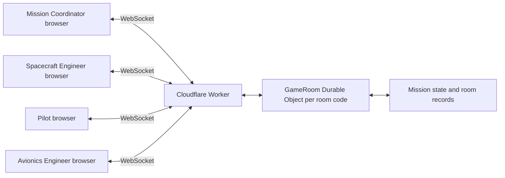

# NAISA

## A Four-Player Cooperative Mars Mission Design Game

NAISA is a browser-based game in which four players design a spacecraft, plan a trajectory to Mars, recover subsurface ice samples, and return to Earth. Each player has different responsibilities, information, and controls. The team must coordinate its decisions across spacecraft design, flight operations, surface exploration, and recovery.

The project introduces systems engineering through decisions that carry consequences into later stages. A larger propellant tank increases available fuel but also adds mass and cost. Frozen sample storage supports the science objective but requires power. A suitable trajectory depends on both planetary positions and the propulsion capability of the selected spacecraft. Successful operation therefore depends on how the complete system meets the mission requirements.

| Item | Details |
| --- | --- |
| Challenge | NASA Space Apps Challenge 2026: Space Mission Design Game |
| Release documented here | Client `NAISA_11.15_EN_v7.html` and server `naisa-server-v8` |
| Players | Four players on separate devices, connected through a shared room code |
| Game language | English |
| Recommended demonstration setup | Four laptops or desktops with keyboards, internet access, and WebGL-capable browsers |
| Technology | HTML, CSS, JavaScript, Three.js, WebSocket, Cloudflare Workers, and Durable Objects |
| Project status | Educational game prototype |

[Official challenge and resources](https://www.spaceappschallenge.org/2026/challenges/space-mission-design-game/?tab=resources)

## Contents

- [Getting started](#getting-started)
- [Mission and learning objectives](#mission-and-learning-objectives)
- [Player roles](#player-roles)
- [Gameplay and design rationale](#gameplay-and-design-rationale)
- [Engineering models and NASA resources](#engineering-models-and-nasa-resources)
- [Scoring and feedback](#scoring-and-feedback)
- [Repository structure and architecture](#repository-structure-and-architecture)
- [Server setup](#server-setup)
- [Current limitations and validation](#current-limitations-and-validation)
- [Review guide](#review-guide)
- [References](#references)
- [Contributions and licensing](#contributions-and-licensing)

## Getting started

1. Select **Code → Download ZIP** on the repository page and extract the archive.
2. Open `NAISA_11.15_EN_v7.html` in a browser on each of the four devices. An internet connection is required.
3. One player selects **Create a room**, then **Create room with this code**.
4. The other three select **Join with a code** and enter the shared room code.
5. Each player chooses a different role. Start the mission once all four roles are assigned, and follow the instructions shown at each stage.

The configured multiplayer server must be available. Players do not need to run the server folder on their own computers. The client currently points to:

```text
wss://naisa-multiplayer.ato1213.workers.dev
```

This is the communication endpoint, not a playable webpage. Server availability and a complete four-device playthrough should be checked before a demonstration.

The current interface hides and disables the server-free solo test button. Although `LocalNet` remains in the source, this release is intended to be evaluated with four players on separate devices.

If a 3D scene does not load, check internet access, WebGL support, and whether the browser or network blocks external scripts. Institutional networks may restrict WebSocket or content delivery network connections.

## Mission and learning objectives

The story takes place in the late 2040s. After the fictional Severian Federation completes the first crewed landing on Mars, NAISA assigns the NOVA-1 team a new objective: investigate subsurface ice in Sector A-17, recover evidence, and bring the crew home safely. One player serves as the Earth-based Mission Coordinator, while the other three take responsibility for spacecraft engineering, piloting, and avionics.

The organizations, mission, sector designation, and narrative events are fictional. NASA exploration history and orbital mechanics provide the scientific context for the decisions made during play.

The intended learning outcomes are to:

- Translate a science objective into equipment and operational requirements.
- Compare trade-offs among mass, cost, power, propulsion, and mission suitability.
- Relate departure conditions and planetary positions to trajectory feasibility.
- Coordinate decisions when expertise, information, and control are distributed across a team.
- Use mission results to explain failures and identify improvements for another attempt.

Players are not expected to understand every engineering concept before starting. The in-game guide, Ni-SAR1114, provides explanations and feedback as decisions become relevant. These are educational design objectives; the project does not yet include an empirical study of learning outcomes.

## Player roles

| Role | Design responsibilities | Operational responsibilities |
| --- | --- | --- |
| **Mission Coordinator** | Reads the full briefing, communicates selected keywords, flags design concerns, and confirms the spacecraft configuration. | Communicates hazards, coordinates solar-storm responses, routes support power during surface exploration, and participates in return-flight observations. |
| **Spacecraft Engineer** | Selects the engine, propellant tank, and upper stage/airframe. | Operates propulsion boosts and uses radar to plan routes for the surface explorer. |
| **Pilot** | Selects sampling and analysis equipment, sample storage, and protection systems. | Steers the spacecraft, collects ice samples on Mars, and controls the final Earth landing. |
| **Avionics Engineer** | Selects communications, power, and navigation systems. | Manages attitude-control actions, maintains antenna alignment and communications, and participates in return-flight observations. |

Roles determine equipment-editing permissions and access to some mission information. All four players must select distinct roles before an online mission can begin.

## Gameplay and design rationale

The mission connects planning decisions to operational consequences. The six parts below describe the design intent; Part 3 includes the MARSBOUND flight game, and Part 5 includes EARTHBOUND, Earth Landing, and the final debrief.

### Part 0: Role assignment and mission briefing

Space missions depend on specialists exchanging information and making coordinated decisions. NAISA represents this through a briefing that only the Mission Coordinator can read in full. Within a limited time, the Coordinator selects a restricted number of keywords to pass to the other players, who use that information to choose equipment.

This makes communication quality part of the design problem. If a critical requirement is omitted or misunderstood, another player may select equipment that performs well in isolation but does not support the mission. The communication system selected during design also affects the number of keywords the Coordinator can transmit.

The intended learning experience is requirements interpretation under information constraints. Dividing the work among four people is only the starting point; the team must also establish a shared understanding of what the spacecraft needs to accomplish.

### Part 1: Spacecraft design

Players select equipment from nine categories: engine, propellant tank, upper stage/airframe, sampling and analysis, sample storage, protection, communications, power, and navigation. Equipment has defined costs, masses, and performance values, including power demand or generation where applicable.

The central consideration is the trade-off between subsystem performance and overall mission suitability. A high-thrust engine can support a heavier spacecraft under the game's acceleration requirement, but may incur a mass or efficiency penalty. A larger solar array generates more power while adding mass. A lighter component may conserve resources but fail to meet a particular operational need.

The ice-recovery objective gives these comparisons a specific purpose. Players must consider the difference between surface scooping and subsurface drilling, as well as the power needed to preserve frozen samples. Their selections feed into total mass, power balance, propulsion capability, and values used in later flight stages.

The shared budget target is **150 game units**. In the current implementation, exceeding that target affects scoring and removes a budget-compliance bonus; it does not automatically block every over-budget selection. Advancing from design requires all nine modules to be selected, any additional keyword selection to be complete, and the thrust-based mass condition to be satisfied. Power shortages are represented in the model and evaluation, but are not a universal progression block.

### Part 2: Orbital trajectory planning

Players vary the departure date, burn direction, and departure velocity change, Δv, to find a feasible route to Mars. They must consider the relative positions of Earth and Mars, available propulsion, required maneuvers, and flight time.

This stage connects trajectory planning to the spacecraft configuration. The selected engine, propellant tank, and upper stage determine the available Δv. If that capability is insufficient, the team can discuss a redesign, with the Mission Coordinator controlling the return to the design stage. Repeating trajectory attempts is therefore only one possible response to an infeasible mission.

The client includes Earth and Mars state data identified in the source as extracted from JPL DE421, together with simplified orbital calculations. GMAT is cited as a reference and as the stated distribution source of the ephemeris file. The browser performs its own calculations; it does not execute GMAT during play.

The learning objective is to make the dependence between planetary geometry, propulsion capability, and trajectory selection visible through experimentation.

### Part 3: Flight operations

After trajectory planning, the team responds to reduced power during solar activity, a Mars-approach correction, a hazardous landing site, and dust or thermal hazards. Players compare the available fuel, power, protection, navigation capability, and structural condition before selecting a response.

For example, a power shortage requires a choice between reducing demand and using available operating margin to continue the mission. A trajectory correction requires balancing propellant expenditure against the consequences of a less effective maneuver. Each event assigns the decision to the relevant role, while the Mission Coordinator can provide supporting information.

These events expose the operational consequences of earlier design choices. Resource margins become useful when conditions change, and the team must coordinate its response rather than rely on one player to resolve every problem.

The subsequent **MARSBOUND: Survive the Solar Storm!** game adds real-time coordination. The Pilot steers, the Spacecraft Engineer controls boosts, the Avionics Engineer manages gyro actions, and the Mission Coordinator operates the high-voltage cutoff. The compressed flight time is a gameplay device, not a representation of actual Earth-to-Mars travel duration.

### Part 4: Mars surface exploration

The surface stage emphasizes simultaneous cooperation among players with incomplete information. The Pilot moves through the terrain and collects three ice samples. The Spacecraft Engineer reads radar returns and sends a route, but those returns do not directly identify every object. The Pilot must combine local observations with the Engineer's guidance.

The Avionics Engineer aims the antenna and maintains the Earth link. The Mission Coordinator monitors sandstorm warnings, alerts the crew, directs temporary power support to the radar, movement, or communications systems, and approves the return once the required conditions are met.

The roles are interdependent. The Engineer can interpret a wider area but cannot collect samples. The Pilot can inspect the immediate surroundings but has limited situational awareness. Communications quality affects support effectiveness, while storms interfere with visibility, radar performance, and the antenna. The team must combine its information to complete the task.

Martian dust and communication difficulties provide the context, but their effects are simplified into understandable game rules. The purpose is to let players experience how shared information and coordinated support enable a common objective.

### Part 5: Return to Earth and debrief

Collecting the samples completes the surface objective, but safe return remains part of the mission. **EARTHBOUND: Dodge the Debris!** requires the Pilot to avoid obstacles while the Spacecraft Engineer manages boosts. The Mission Coordinator and Avionics Engineer observe and count objects that match assigned criteria. This gives players who are not directly steering an operational contribution to the team result.

The **Earth Landing** stage follows the capsule's descent, parachute deployment, and splashdown. The final scrolling results screen presents the mission outcome, team rating, individual contributions, MVP recognition, and supporting explanations.

The debrief is intended to support reflection on decisions throughout the mission. Players should be able to connect a result to an equipment selection, a missed requirement, a resource constraint, or a coordination problem, then propose a different approach for the next attempt.

### Design principle across the mission

Each part emphasizes a different constraint: mass and power during design, propulsion and flight time during trajectory planning, resource margins during operations, and information sharing during exploration. The common principle is that individual decisions affect the performance of the complete system.

NAISA aims to make this relationship accessible through play and feedback. Mission success depends on how equipment, resources, and specialist decisions work together under a common set of requirements.

## Engineering models and NASA resources

### Spacecraft calculations

The selected equipment determines total cost, dry mass, propellant-loaded mass, electrical demand, power generation, and available Δv. Propulsion calculations use the ideal rocket equation:

```text
Δv = Isp × g₀ × ln(m₀ / mf)
```

Here, `Isp` is specific impulse, `g₀` is standard gravitational acceleration, `m₀` is mass before the burn, and `mf` is mass after the burn. The code computes upper-stage and spacecraft Δv separately. Mass is expressed in kg, power in W, thrust in N, and Δv in km/s, with consistent unit conversion in the calculation. Costs use game units.

The thrust-based mass condition is simplified to:

```text
Allowable mass = thrust / required acceleration
Required acceleration = 1 m/s²
```

This is an educational in-space maneuvering condition. It does not represent the payload capacity of a launch vehicle lifting off from a planetary surface.

### Trajectory calculations

The client contains the planetary state table `EPH` and the orbital calculation module `ASTRO`.

| Component | Implementation |
| --- | --- |
| Planetary state data | An embedded table identified in the code as extracted from JPL DE421, distributed with GMAT R2026a at `data/planetary_ephem/spk/de421.bsp` |
| Sampling | 150 state vectors per planet at four-day intervals, starting on January 1, 2048; each vector contains three position and three velocity components |
| Interpolation | Cubic Hermite interpolation between samples |
| Interplanetary propagation | Fourth-order Runge–Kutta integration under solar gravity |
| Departure and arrival | A patched-conic approximation with separate Earth-escape and Mars-capture calculations |
| Trajectory correction | A Lambert solution is used to evaluate corrected departure conditions and arrival velocity after a close-approach criterion is met |
| Feasibility checks | Required departure and spacecraft Δv are compared with design capability, together with flight-time constraints |

The game uses embedded data and JavaScript calculations. It does not call a live NASA data API. JPL ephemerides describe planetary motion using models informed by observations; the spacecraft paths shown in the game are computed trajectories.

The `0.03 AU` approach threshold is a search criterion for attempting trajectory correction. It is not a Mars-landing accuracy requirement or an acceptable final navigation error.

The release does not include the original `de421.bsp`, the `tools/extract_ephem.py` script mentioned in source comments, a GMAT executable, or a separate validation report. Reproducing the extraction process and independently checking all numerical results therefore requires additional material. Numerical comparisons with real missions displayed within the game should be distinguished from validation that can be reproduced from this repository alone.

### Data provenance and educational simplifications

| Resource or content | Use in NAISA |
| --- | --- |
| **NASA GMAT** | Reference for mission and trajectory design, and the distribution source identified by the code for the planetary ephemeris file. Installing GMAT is not required to play. |
| **JPL DE421** | Stated source of the embedded Earth and Mars state data. It is not a live observational feed. |
| **NASA exploration examples** | Phoenix, TRIDENT, communications relays, power systems, thermal protection, and Stardust provide context for equipment explanations and operational hazards. |
| **Game parameters** | Equipment costs, masses, performance values, mission-fit ratings, selected thresholds, and scoring rules are educational design values. |
| **Fictional mission** | NOVA-1, Sector A-17, crewed Mars return, and frozen-sample recovery form the game scenario. They do not describe completed NASA missions. |

NAISA is an educational prototype, not an official NASA product or a tool qualified for mission operations or flight certification.

## Scoring and feedback

The full-mission evaluation in `missionRating()` uses the following weights:

| Category | Weight | Main inputs |
| --- | ---: | --- |
| Spacecraft design | 45% | Equipment suitability and mass, power, and budget conditions |
| Trajectory and flight decisions | 20% | Δv margin, flight time, event responses, and assistance use |
| MARSBOUND | 10% | Arrival, retry status, and emergency fuel assistance |
| Mars exploration | 20% | Number of recovered ice samples |
| Earth return | 5% | Combined EARTHBOUND and Earth Landing results |

Individual evaluations also consider role-specific equipment choices, mission keywords, event decisions, and exploration performance. Ni-SAR1114 assistance, redesigns, and retries have additional scoring or contribution rules. Arrival with emergency fuel assistance in MARSBOUND or EARTHBOUND records a raw score of 40 for that stage.

Mission-fit ratings use a developer-defined assessment table. Scores support gameplay and reflection; they are not standardized measures of engineering quality or professional competence.

The code also maintains an earlier design-and-flight `teamScore` and room-specific records separately from the full-mission weighted evaluation. These values should not be treated as interchangeable. The current server stores its leaderboard per room.

## Repository structure and architecture

```text
.
├── README.md
├── .gitignore
├── NAISA_11.15_EN_v7.html
└── naisa-server-v8/
    ├── wrangler.jsonc
    └── dist/
        └── worker.mjs
```

| File | Purpose |
| --- | --- |
| `NAISA_11.15_EN_v7.html` | Integrated client containing the interface, design and trajectory calculations, embedded minigames, and media. No separate frontend build is required. Some resources, including Three.js and fonts, load externally. |
| `naisa-server-v8/dist/worker.mjs` | Handles room membership, role permissions, mission state, scoring, persistence, and real-time message relay. This file is required despite its location in a `dist` directory. |
| `naisa-server-v8/wrangler.jsonc` | Defines the Worker entry point, `GAME_ROOM` binding, `GameRoom` class, and initial migration. |
| `.gitignore` | Excludes local development state, temporary files, and secret configuration files. It does not exclude `dist/worker.mjs`. |



The client and server contain the same `NaisaCore()` rules. The server processes the main design and mission-state transitions and distributes player-specific views. During minigames, the Pilot's browser controls some simulation and outcome decisions while the server relays inputs and state messages. The server does not independently recompute every physical result or score.

## Server setup

This section is for developers reproducing the multiplayer service. The server targets Cloudflare Workers and Durable Objects; it cannot be started as a conventional Node.js application with `node worker.mjs`.

### Local development

With Node.js and npm available, start the local Worker from the server directory:

```bash
cd naisa-server-v8
npx wrangler dev
```

Update the client's `SERVER` constant to match the address reported by Wrangler. For example, a local server on port 8787 uses:

```text
ws://127.0.0.1:8787
```

This is a development address for the same computer, not a public endpoint that remote teammates can use.

### Deployment to a separate account

After checking the intended Cloudflare account and project configuration, authenticate and deploy:

```bash
npx wrangler login
npx wrangler deploy
```

Set the client's `SERVER` constant to the resulting Worker address using `wss://`. All four players must use the updated client. The `/status` response should report the protocol expected by this release:

```text
team-design-v8-finale
```

A successful status response checks service reachability and the reported version; it does not verify a complete game session.

This release does not include a `package.json` or dependency lockfile. Running `npx` may download Wrangler. Record the tool versions used if an identical development environment is required. See the [Cloudflare Durable Objects setup guide](https://developers.cloudflare.com/durable-objects/get-started/) for environment requirements.

Publishing the repository shares its code and documentation. Hosting the playable client and running the multiplayer service are separate steps. [GitHub Pages](https://docs.github.com/en/pages/getting-started-with-github-pages/what-is-github-pages) can serve the static client, but the Worker backend must run separately.

## Current limitations and validation

| Area | Current scope |
| --- | --- |
| Device support | Four separate browser connections are supported by the architecture. Several stages require keyboard input; completing the entire mission through phone touch controls alone is not established. |
| Communications | Earth Landing includes the `CREW COMMS` text panel. A persistent chat panel spanning all stages has not been confirmed. Voice communication is external; there is no built-in voice call feature. |
| Reconnection | If a player disconnects during a mission, the room returns to the lobby. Resuming an interrupted mission is not supported. |
| Distribution | The integrated HTML is approximately 29.1 MiB because it embeds media. Separate minigame source packages and media production files are not included. |
| Scientific reproducibility | The ephemeris extraction tools, original kernel, and independent numerical validation package are not included. |
| Educational evaluation | Learning objectives are defined, but measured learning gains and usability study results are not included. |

Release preparation checked that the client and server share the same core rules, that the embedded planetary table has the documented structure, and that the extracted main scripts and server pass JavaScript syntax checks. These checks do not establish full four-device completion, cross-browser compatibility, or numerical agreement with GMAT. Those require separate validation.

## Review guide

The following questions connect the project's design objectives to its implementation.

| Review area | Questions for evaluation | Relevant implementation |
| --- | --- | --- |
| Systems engineering | Are the trade-offs understandable? Do equipment choices connect to the science objective and subsequent operations? | Design interface, `MODULES`, `metrics()`, `MISSIONS.ice` |
| Trajectory modeling | Are units and approximations explicit? Does trajectory feasibility depend on the spacecraft's available Δv? | `EPH`, `ASTRO`, in-game orbital science notes |
| Cooperative design | Do information and control differences create useful interdependence among all four roles? | Briefing, design, and surface exploration; server `handle()` and `view()` |
| Software architecture | Are responsibilities for state transitions, persistence, simulation, and message relay clear? | `GameNetwork`, `GameRoom`, minigame integration code |
| Feedback and learning | Can players explain a result and identify a change for their next design? | Final results, `missionRating()`, role-specific evaluation reasons, Ni-SAR1114 guidance |

## References

- [NASA Space Apps: Space Mission Design Game Resources](https://www.spaceappschallenge.org/2026/challenges/space-mission-design-game/?tab=resources) provides the challenge context and official resource list.
- [NASA GMAT repository](https://github.com/nasa/GMAT) provides the mission design software and related material.
- [JPL Planetary and Lunar Ephemerides](https://ssd.jpl.nasa.gov/planets/eph_export.html) describes planetary ephemerides, including DE421.
- [NASA Glenn: Ideal Rocket Equation](https://www1.grc.nasa.gov/beginners-guide-to-aeronautics/ideal-rocket-equation/) explains the relationship among mass, propulsion, and Δv.
- [NASA Glenn: Thrust to Weight Ratio](https://www1.grc.nasa.gov/beginners-guide-to-aeronautics/thrust-to-weight-ratio/) provides background on thrust, mass, and gravity.
- [NASA Mars Exploration Program](https://science.nasa.gov/planetary-science/programs/mars-exploration/) provides exploration context linked from the game introduction.
- [NASA/JPL: Stardust Encounters Solar Flare](https://www.jpl.nasa.gov/news/stardust-spacecraft-encounters-solar-flare/) provides a mission example behind the solar-storm scenario.

Additional equipment references appear in the game's **Learn More** section and science notes. This README documents the client and server release dated November 15, 2026, together with the project's stated design rationale.

## Contributions and licensing

This release does not yet include a project-wide `LICENSE` file or a separate record of team contributions and AI-assisted work. External libraries, images, videos, and fonts remain subject to their respective terms of use.

NASA Space Apps submission status, eligibility, and compliance with event rules must be established separately from the technical description in this repository.
